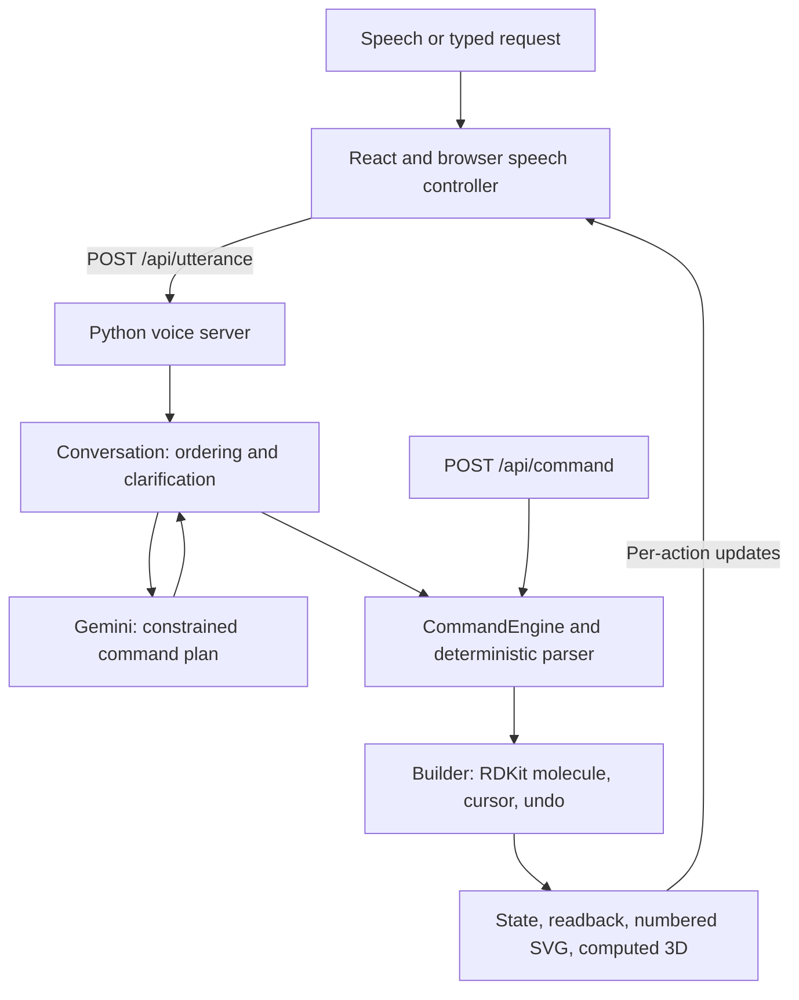

# ChemSpeak

Chemistry education often depends on seeing and drawing molecular structures. ChemSpeak aims to make molecule building more accessible to blind and low-vision learners and people who find mouse-based drawing difficult. Spoken commands, numbered atoms, and audible readback let users explore a structure, while live 2D and 3D views give teachers and classmates a shared visual reference. This educational prototype still needs usability evaluation with intended users.

## Setup and use

Use Python with RDKit support (the code uses Python 3.9-compatible syntax), Node.js 22+, and npm. Chrome is the initial browser target for microphone input.

```powershell
# Windows PowerShell, from the repository root
python -m venv .venv
.\.venv\Scripts\Activate.ps1
python -m pip install -r requirements.txt
npm ci
npm run build
$geminiSecret = Read-Host "Enter Gemini API key" -AsSecureString
$env:GEMINI_API_KEY = [System.Net.NetworkCredential]::new("", $geminiSecret).Password
python voice_server.py
```

On macOS or Linux, create the environment with `python3 -m venv .venv`, activate with `source .venv/bin/activate`, and use the same install/build commands. Set `GEMINI_API_KEY` in the server environment before starting `python voice_server.py`. Keep keys out of source files and browser code. `GEMINI_MODEL` optionally overrides the implementation's default, `gemini-3.5-flash-lite`; access and quota depend on your Google project.

Open <http://127.0.0.1:8001/>. Use headphones, enable the microphone, allow permission, then say **Start** as a separate utterance. Try "add a carbon then add oxygen", "read it back", "go to atom one", and "undo". Typed requests remain available. Ask "help" or "what can I add" for supported commands.

**Pause** suspends commands, including Undo; **Start** resumes. **Stop** turns off recognition, but submitted work still completes. **Skip** interrupts spoken feedback while staying in command mode. Mute and startup-instruction replay are available. If autoplay blocks the welcome, interact with the page or activate **Hear startup instructions**. Replay turns off recording.

For frontend development, keep the Python server running and run `npm run dev` in another terminal. Open <http://127.0.0.1:5173/>; Vite proxies `/api` to port 8001. Run `npm run build` again to update the Python-served React interface.

## Architecture



The browser submits finalized speech segments rather than changing interim transcripts. `interpreter.py` sends text and molecule context to Gemini through standard-library HTTPS with a JSON Schema response format. `conversation.py` validates the returned plan, executes clear actions in order, and manages clarification. `command_engine.py` dispatches canonical commands through `parser.py` to `builder.py`. RDKit owns molecular state and chemistry validation.

`voice_server.py` provides `/utterance`, `/command`, `/state`, `/image`, and `/structure3d`, with `/api` aliases for React. Utterance responses stream newline-delimited JSON so the interface can update after each action. Mutations are serialized; canonical and AI commands share one molecule and undo history. State is in memory for one session per server process. Restarting loses the session, and separate processes do not share state.

`readback.py` produces composition and numbered connection descriptions. RDKit creates numbered 2D drawings and a computed 3D conformer, rendered in the browser with 3Dmol.js. The 3D view is illustrative, not experimental geometry or a stereochemical model.

## Design decisions

| Decision | Reason and tradeoff |
| --- | --- |
| AI interprets language; RDKit validates chemistry | Flexible phrasing maps to canonical commands, which deterministic code checks before any edit. The model cannot directly replace molecular state. |
| Validate changes on private copies | Failed edits leave molecule, cursor, and history unchanged. Chains, groups, and ring templates are atomic actions. Successful state changes, including cursor moves, are undoable. |
| Numbered atoms and a current-atom cursor | Speech, readback, and drawings share 1-based references. New atoms attach to the cursor by default; explicit targets avoid extra navigation. Deletion can renumber remaining atoms. |
| Execute the clear prefix and stop at confusion | Accepted steps remain. The confusing instruction is held for clarification; everything after it is discarded and must be repeated. This avoids dependent edits based on guesses. |
| Finalized speech and ordered requests | Prevents changing transcripts and out-of-order requests from producing unpredictable edits, at the cost of recognition and API latency. |
| No automatic mutation retries | A lost response does not prove an edit failed; retrying could duplicate accepted work. |
| Browser speech with typed fallback | Avoids Python microphone dependencies. Browser support, permissions, network access, and acoustics remain constraints. |
| One local session with same-origin serving | Keeps the demo simple and gives both command routes one undo history. There is no multi-user isolation or durable storage. |
| Curated named structures | `library.py` loads fixed SMILES instead of guessing structures. `naming.py` queries PubChem for a current molecule's name without modifying chemistry. |

Supported placed elements are carbon, oxygen, fluorine, chlorine, bromine, and iodine; hydrogens are implicit. Single, double, and triple bonds obey valence limits; halogens use single bonds. Chains, functional groups, rings, deletion, bond changes, and curated molecule loads are supported. Other elements, charges, radicals, stereochemistry, mechanisms, and arbitrary name-to-structure generation are outside scope.

Browser recognition may send audio to its provider. Gemini receives submitted text and molecule context; PubChem receives current SMILES for name lookup. The page loads fonts and 3Dmol.js from external hosts, so it is not fully offline. API credentials stay on the Python server.

## Project map

| Files | Purpose |
| --- | --- |
| `web/src/` | React interface and styling |
| `web/browser-controller.mjs`, `web/session.mjs`, `web/startup.mjs` | Recognition, request ordering, speech controls, startup guidance |
| `voice_server.py`, `conversation.py`, `interpreter.py` | HTTP service, clarification workflow, Gemini integration |
| `command_engine.py`, `parser.py`, `builder.py` | Dispatch, canonical parsing, transactional RDKit edits |
| `readback.py`, `export.py`, `library.py`, `naming.py` | Descriptions, images, curated structures, PubChem names |
| `main.py`, `speech.py` | Terminal interface and platform speech adapters |
| `api.py` | Alternative deterministic Flask API on port 5000, with its own session |
| `tests/`, `web/*.test.mjs` | Backend and mocked browser tests |
| `gemini_test.py`, `start_notebook.ps1` | Optional live diagnostics and Windows launcher |

The original browser interface remains at `/voice-app.html`. `web/voice-demo.html` is an isolated fake-service microphone demo and does not build molecules. The terminal runs with `python main.py` or `python main.py --quiet` and generates `outputs/current.png`. Terminal speech uses macOS `say`, Windows System.Speech, or Linux `spd-say` when available.

See [API.md](API.md) for integration details, [SPEC.md](SPEC.md) for scope, and [DECISIONS.md](DECISIONS.md) for historical decisions. Older entries describe earlier implementations; this README describes the completed architecture.

## Verification

```sh
python -m pytest
node web/voice.test.mjs
node web/session.test.mjs
node web/startup.test.mjs
node web/browser-controller.test.mjs
npm run build
```

Automated tests mock model calls, external lookups, and browser speech. Check microphone permission, controls, readback, clarification, Undo, and live interpretation manually in Chrome. `python gemini_test.py` is a separate live diagnostic consuming up to two API requests.

Generated caches, `outputs/`, `.venv/`, `node_modules/`, and `web/dist/` are ignored by Git. Dependencies and frontend output can be recreated with the setup commands above.
